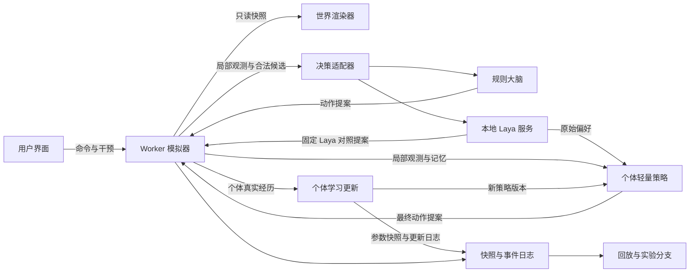

# 技术架构

状态：P0 已采用 React/TypeScript/Vite、PixiJS 与 ECharts；M0 的 TS 单体环境、Python JSONL 桥、真实 Laya、独立 PPO、HTTP 与记录恢复已验证，见 [结果](m0/RESULTS.md)。下文的完整生态、Worker 和浏览器存储仍属后续设计；原型脚本与真实记录页分开标识。

## 1. 技术选择与职责

| 模块 | 拟选技术 | 职责 |
| --- | --- | --- |
| 页面与观察面板 | React + TypeScript + Vite | 控件、信息面板、实验管理 |
| 世界渲染 | PixiJS，必要时简化为 Canvas 2D | 大量生命体、资源场、镜头与选择 |
| 指标图表 | ECharts，待 P0 验证 | 成长与对照曲线、交互提示 |
| 模拟核心 | 独立 TypeScript 模块，运行于 Web Worker | 固定时间步、世界状态、资源、个体、遗传 |
| 本地模型服务 | Python + FastAPI + Laya | 加载单份权重、批量推理、健康状态 |
| 个体学习运行时 | 本地 Python 服务内的独立模块，训练库由 M0 验证后确定 | 小策略推理、个体参数与优化器、有界训练、学习快照 |
| 状态保存 | Dexie / IndexedDB + 可导出文件 | 世界快照、决策记录、实验结果及学习检查点关联 |

具体版本、许可证和运行要求在实施前核实并锁定；本文件不假定某个 SDK 版本的函数签名。第一版以同一台机器上的浏览器与本地服务为目标，不依赖外部账户。

M0 已实际验证 Gymnasium、SB3-Contrib 与 TorchRL 探针，当前选择 SB3-Contrib MaskablePPO 作为独立小策略实现。世界仍由同一 TS 模块拥有，Python 通过 JSONL 驱动；没有第二份 Python 世界。TorchRL 未进行同预算效果排名，PettingZoo、TensorBoard 与其他 [候选](OPEN_SOURCE.md) 不自动成为生产依赖。

TS Worker 与 Python RL 之间存在桥接成本。M0 应验证同一 TS 模拟模块在无界面进程中的批量运行方式，不另写一份 Python 生态规则。Mesa/līlā 可作为改变世界归属的备选，但当前不据此自动切换架构；世界归属决策在 M1 前完成。

## 2. 数据流



世界状态只有模拟器能修改。React 不保存每个个体的实时坐标。渲染器消费位置快照，使用插值表现平滑运动；插值不改变模拟结果。

算法验收须可脱离画布运行。同一记录切换柔团、尾游、节虫外观，不改变观测、动作、奖励或学习状态；前端不能为了呈现戏剧性结果额外驱动觅食、躲避或合作。初期算法比较使用相同身体条件，功能性体型差异后续独立验证。前端的摄食、拒绝、能量变化和死亡表现均由执行事件触发，具体协议从 [M0 验证切片](m0/FIRST_EXPERIMENT.md) 开始落实。

主路线为“固定 Laya + 个体轻量学习网络”，固定 Laya 直连执行器是基线模式。学习细节见 [持续学习方案](LEARNING.md)。Python 学习运行时是策略参数与优化器的唯一写入者，模拟器拥有世界与实际经历，二者通过版本化记录交接。物种、全局环境和其他个体的隐藏状态不进入训练输入。

## 3. 时间与并发

- M0 后确定的 M1 初始预算为 8 个体、10 个模拟步/模拟秒、每 10 步决策一次。M0 本身每个单体动作步做一次决策；8 个独立实例联合测量的整轮中位约 1.92 秒，不承诺墙钟实时，也不代表共享生态已经实现。见 [runtime-budget.json](../experiments/m0/config/runtime-budget.json)。
- 在决策边界冻结同一状态，为所有到期个体构造输入并批量提交。
- 首版采取有界并发的同步决策屏障：结果齐备后按个体 ID 的确定顺序应用，网络完成顺序不能改变结果。
- 批量处理不意味着同一请求塞入整个世界；每个个体仍只有自己的局部输入。
- 等待期间界面保持响应并显示“等待决策”；模拟时间暂停，避免不同硬件产生不同世界演化速度。
- 倍速表示期望模拟推进倍率；实际速度受推理吞吐限制，显示实际推进率，不承诺模型模式下的高倍速。
- 模型调用不会无限堆积。每个运行维护决策轮次 epoch；重置、切换实验、修改冻结状态或主动取消均使旧 epoch 失效。即使模拟步相同，也不能接收旧轮次响应。
- 单纯暂停不改变世界与 epoch：已返回结果可暂存，但必须等恢复或用户单步才提交。保存与分支在已完成动作提交的步边界进行，不复制正在等待的网络请求。
- 地形编辑及其他用户命令在步边界依序应用；放置障碍不能覆盖生命体或造成无效状态。

首版不引入自由异步的个体决策。后续若需要异步更新，必须重新定义时序与回放规则。

学习在预定决策边界处理：先结清上次动作经历，再按预算更新个体策略，最后用已确认的新策略版本进行下一次决策。更新期间模拟时间暂停，渲染保持响应。单纯暂停世界也暂停新学习提交；暂停参数学习则仍允许用固定参数行动和按约定更新记忆。

## 4. 世界更新与一致性

固定顺序建议为：应用用户命令 → 资源补给与扩散 → 执行动作与移动 → 摄食及资源竞争 → 代谢 → 死亡处理 → 繁殖提案结算 → 更新记忆与事件 → 生成观测快照。

同一资源的竞争采用确定性分配规则，不能让两个生命体各自吃到同一份资源。使用稳定排序，并在需要随机打破平局时调用受控随机数源。冲突规则需要记录在模拟版本中。

动作分为持续动作和一次性动作。移动、觅食与休眠持续至下一决策边界或条件失效；繁殖提案每个决策只结算一次。拒绝的动作本轮不自动重复执行，个体保持待机并继续支付基础代谢，下次决策时重新选择。出生个体从下一模拟步开始参与更新。

“资源 + 个体储能 + 累计消耗/损耗”应等于“初始总量 + 累计外部补给”，在数值容差内闭合。繁殖转移、死亡回收与用户投放均写入账本。

## 5. 决策接口

以下是我们自己的领域协议，不是 Laya SDK 的现成接口。

### 请求

- 协议版本、运行 ID、决策 epoch、逻辑决策 ID、尝试 ID、模拟步、快照 ID、个体 ID。
- 自身可用状态：能量档位、年龄、表达出的性状、当前活动。
- 感知：相对位置、可观察的目标属性、局部环境。
- 有限记忆：地点、发生过的事件、距今模拟时间。
- 候选动作：稳定动作 ID、目标 ID 或相对目标、简短且原子的说明。
- 决策题目及输入模板版本。
- 大脑模式、学习运行 ID、个体策略 revision、观测与候选编码版本、探索配置及随机状态引用。

以上身份字段用于系统关联，不全部传给模型。模型仅看到个体许可的观测与本次候选的局部编号；适配器维护局部编号到内部目标 ID 的映射，避免稳定 ID 意外泄露年龄或谱系。地点记忆对模型表达为相对方位与经历，不暴露全局坐标。

协议必须固定单位：位置和距离用世界单位，能量用统一的模拟能量单位，年龄与记忆有效期用模拟步；推理耗时和请求超时用真实时间毫秒。不能因网络等待让模拟年龄增长。候选集必须包含待机/休眠项；数值非有限、候选为空或输入被截断时显式报错，不提交缺失关键信息的请求。

### 响应

- 原逻辑决策 ID、尝试 ID、决策 epoch、选择的动作 ID、模型实际返回的概率分布与置信信息（若有）。
- provider、模型及 checkpoint 标识、SDK 与适配器版本。
- 推理耗时、输入摘要哈希、错误与降级信息。
- 主路线另含 Laya 原始偏好、小策略最终分布、行为策略版本、选择时的动作概率及探索随机记录；各阶段来源分别标注。

模型输出先经过结构与动作 ID 验证，再作为提案送回模拟器。执行器再次验证当下条件，并记录成功或拒绝原因。UI 区分“模型选择”和“实际执行”。

概率与置信度只按其真实接口含义展示，不将其解释成生存成功率。固定 Laya 基线默认采用其返回动作；路线 B 训练时按已配置的探索策略从最终合法分布采样，使用独立受控随机流。评估采用采样还是最大概率选择须预先固定，不能挑选有利设置。组合后的分布不得沿用 Laya 的校准声明。

## 6. Laya 集成策略

M0 先核实官方 SDK、可用 checkpoint、输入长度、批量接口、设备后端和许可证。在目标机器上比较适合短决策的候选模型，不假定中文、MLX 或某个 checkpoint 必然更好。

先构建约 30–50 个简短情境：低能量且附近有食物、目标不可达、没有合法繁殖条件、记忆过期、多个同类争用资源等。拆分明确规则情境与没有唯一正确答案的策略情境。

- 明确规则情境用于衡量合法性和基本理解。
- 策略情境用于观察一致性、性状敏感性和长期后果，不强制贴上单一正确标签。
- 调参用例与最终验收用例分开，防止只适应展示样例。
- 单个体短输入先跑通，再测批量 8、16、32、48 个体，记录冷启动、热启动、内存和端到端耗时。
- 不把示例项目的性能直接外推为本项目结果。

Laya 适配器只负责无状态推理，共享一份固定权重；个体状态与行为记忆属于模拟器。首个学习版本训练独立的小策略，不修改 Laya 权重，也不加入 Jev 级联。直接持续微调 Laya 保留为路线 C，主路线跑通后另做研究。

M0 还需验证完整候选偏好能否正确映射到小策略、联合推理与训练资源预算，以及单个体的最小反馈更新。多实例只共享固定 Laya，不共享可训练参数、优化器、经验池或在线归一化统计。

## 7. 故障与模式语义

健康状态区分未安装、加载中、就绪、推理中和故障。模型不可用时，用户仍可选择规则模式。

严格实验：超时或无效输出暂停，保留现场并允许重试或显式切换模式。

首版不自动重试。用户触发重试时，保留逻辑决策 ID，创建新的尝试 ID，并先使旧尝试失效。旧尝试迟到的结果记录后丢弃；一个逻辑决策最多提交一次动作。手动重试次数和每次耗时均进入记录，不能只保留最后一次成功。超时时间通过 M0 测量设为运行配置，不能无限等待。

同一决策轮次部分成功时暂存成功提案，仅对失败项允许重试；全部就绪前不改变世界。若用户在此时干预世界，则废弃整轮并基于新快照重新决策。反复重试或切换模式始终保留在原运行历史中。

首版不设置跨决策的响应缓存。回放读取记录不计为新推理；重复情境测试需要实际新调用，并记录服务端缓存状态（若后端提供）。同样的结果不等于缓存命中，也不证明独立样本。

探索运行：可允许规则降级，但必须显示状态，并为受影响的每次决策记录真实 provider。不得仅因“置信度低”就默认调用另一个模型，阈值需另行验证。

学习运行时使用 `(学习运行 ID, 个体 ID, 训练批次 ID, 输入 revision)` 作为更新身份，校验数据范围并生成新 revision；同一批次最多提交一次更新。重试须查询已提交结果，不再执行梯度步。重置、分支与整轮失效隔离旧运行，过期训练结果不可覆盖新参数。采用可回滚的提交边界，跨组件未确认的更新不能进入新决策。

世界经历以个体、行动与时间区间唯一标识，防止重复奖励或重复入库。部分个体训练失败时不推进下一轮，成功更新暂存；重试或恢复按更新清单完成，不重新训练已成功部分。严格学习实验默认失败暂停；探索降级产生的非当前策略数据按学习方案隔离。学习服务实际持有的已提交版本与模拟器引用版本必须一致。

## 8. 保存、回放与分支

运行清单至少包含世界配置、模拟版本、随机数算法与完整状态、环境和个体快照、模型版本、输入模板版本、决策记录与用户干预事件。

路线 B 追加每个个体的参数、优化器、有限经验缓冲、编码/归一化配置、学习与探索随机状态、更新清单、策略 revision、奖励定义版本、更新日程和未结清行动。快照在世界与学习状态共同确认的边界生成，不保存半提交训练；分支使用新运行 ID，并深复制所有可变状态。

严格回放不重新调用模型，按记录动作和事件恢复世界。固定种子只控制模拟器的随机性，不能保证在线模型、后端或依赖升级后的响应一致。

展示回放不重新训练，只读取记录的更新事件与检查点。M3 基础生态按世界状态哈希验证；M5 区分世界回放一致与完整学习恢复一致。跨硬件梯度计算不承诺逐位相同，训练恢复先在锁定运行时验证版本、状态和容差。只有动作日志的导出文件应标记“可观看、不可继续训练”；不得从缺失优化器或经验的文件声称恢复了原学习过程。

首版回放支持暂停、单步和从快照重放；任意时间拖动跳转可后续增加。使用带版本的导出格式，默认同版本回放，不承诺跨版本自动兼容。记录容量有上限，提供分段导出并明确何时停止记录，不能静默丢失仍声称完整回放。

实验分支复制同一个快照和随机数状态，并记录唯一改变的配置。不同大脑导致事件数量变化后，随机数使用也可能分叉；同一 seed 不等于每次随机扰动都一一配对。正式比较使用多个种子、明确指标和重复实验。

## 9. 拟建目录

```text
apps/web/                页面、渲染与用户交互
packages/sim/            无 UI 依赖的模拟核心
packages/protocol/       命令、快照与决策类型
services/laya/           Python 模型适配与服务
services/learning/       个体策略、优化器与有界训练模块，首版与本地服务同进程
experiments/             情境集、实验配置和评估脚本
docs/                    产品、架构、任务与决策记录
```

目录仅为后续实施建议，当前不创建空应用或占位实现。

## 10. 设计阶段的链路复核

复核范围为局部观测、决策适配、执行、保存与回放。只有方案文本，尚无代码、运行日志或测试结果；以下均为设计约定和待执行验证，不是运行正确性结论。

| 边界或维度 | 文档发现与处理 | 实施时验证 |
| --- | --- | --- |
| 正常与失败路径 | 已明确模型只提交提案，部分失败不推进世界 | 对完整成功、单项失败和超时分别验证世界提交次数 |
| 类型与语义 | 原方案缺少单位、模型可见 ID 和空候选约定，已补充 | 序列化往返保留单位，输入不含全局身份信息，截断显式失败 |
| 状态与副作用 | 只用快照 ID 不足以区分同一步取消与重试，已增加 epoch 和尝试 ID | 暂停、取消、同一步重试及迟到响应不会重复动作 |
| 不变量与预算 | 已明确能量账本、单次繁殖、上限、队列与等待约束 | 长时间运行、资源竞争、过期响应和上限情境测试 |
| 路径差异 | 固定种子不足以保证模型重跑等同回放，已区分 | 记录回放比较状态哈希；不同大脑比较行为指标 |
| 复制、采样与缓存 | 首版不做跨决策缓存，回放不得当作新推理证据 | 检查真实调用数、重试次数和每次结果来源 |
| 共享与合并 | 多个生命体共享资源与冻结快照，不共享隐藏观测 | 打乱响应完成次序，执行结果仍符合固定冲突规则 |
| 可执行验证 | M0 最小世界、真实推理、学习、恢复与记录已验证 | 完整生态、Worker 与长期多体交接仍由 M1/M3 验证 |
| 学习更新与归属 | 新增路线 B，需隔离个体状态、去重训练与奖励 | M5 检查重复请求、死亡结算、参数隔离和部分更新失败 |
| 完整学习恢复 | 世界动作回放不等于训练续接，已扩展快照范围 | 冻结回放无梯度更新，继续学习从完整检查点恢复 |
