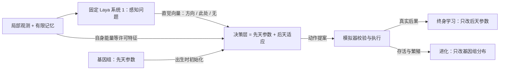

# 路线 D：进化先天 + 终身学习，Laya 作系统 1

状态：2026-10-02 用户确定方向并授权推进。本文件是该路线的设计、证据与切片记录。路线 B（固定 Laya + 个体 PPO）保留为对照，不删除。

## 1. 决策与动机

用户选择：(1) 进化（先天）加终身学习（后天）；(2) Laya 仍是主角，理解为“系统 1”——快速、直觉式的感知与判断。

起因是 2026-10-02 对已有开发数据的复盘（开发集，3 个种子，仅作线索）：固定 Laya 直接选动作时最终存活 0/0/0（规则 6/6/8，学习约 3/8），且 91% 动作为南北来回移动、进食 0.4%。随后用受控反事实场景诊断（见 §2）定位到原因：**接口，而不是 Laya 看不懂世界**。

## 2. 证据：Laya 作为“动作选择器”和作为“感知直觉”表现完全不同

诊断方法：`services/ecology/laya_probe.py`、`laya_interface_probe.py`。受控单食物场景（食物放在个体周围 |dx|+|dy|≤3 的各位置，两种能量、三种食量，共 150 个有食物场景 + 6 个无食物），不执行动作、不训练；真实 Laya（MPS，laya 0.3.21，模板 `ecology-local-en-v1`）。判据“朝食物”：移动后距离变小的合法动作，脚下有食物则为进食。结果文件在 `experiments/ecology/evidence/laya-probe-01`、`laya-probe-02-reverse`、`laya-interface-probe-01`。

| 提问方式 | 最高概率动作朝食物 | 说明 |
| --- | --- | --- |
| 动作多选题，固定顺序 | 66% | 看似不错，但被位置混淆 |
| 同上，**候选顺序反转** | 11%（随机约 29%） | **位置偏置**：排第一的选项平均拿到约 50–70% 概率，反序后“休眠”排第一得 60% |
| 同上，完整拉丁方平衡（每个动作各排首位一次） | 81%，AUC 0.90 | 内容信号真实但中等；需 n 次查询 |
| 逐动作“是不是好选择”（是非题） | AUC 0.72 | 与顺序无关但信号弱 |
| **“最近的食物在哪个方向”多选题**，固定顺序 | 85% | 单次查询即较好 |
| 同上，完整拉丁方 6 轮换 | **100%（150/150），AUC 0.9993** | Laya 能准确读出方向 |

其他观察：脚下有食物时，动作多选题给“进食”的概率几乎与能量无关（能量 8 与 30 都约 0.28），即**对饥饿不敏感**；无食物场景下方向题给“没有食物”只有约 0.28（缺失检测弱，样本仅 6 个）。早先一次只用 4 个循环顺序得到的“100%”是不平衡造成的假象（“休眠”从未排首位），已用完整拉丁方更正。

**含义**：Laya 擅长读场景（方向、有无），不擅长在选项列表里“做决定”，也不知道自己的能量处境。这正是系统 1 的角色：快速给出感知性直觉；决策与适应交给后面的层。

限制：受控单食物场景、单一模板、不含生存结果；只能说明“读方向”能力，不能说明在生态里的收益。

### 2.1 在真实模拟观测上的结果（比受控场景更重要）

语料：`experiments/ecology/evidence/percept-corpus-01`（960 条，来自 8 个世界，4 个规则控制器 + 4 个随机控制器；原计划 48 个世界，因 CPU 与进化任务竞争而手动停止，见该目录 NOTE.md）。分析：`services/ecology/percept_analysis.py` → `analysis.json`。真值来自个体自己的局部观测。

- 固定顺序方向题的**原始准确率只有 6.0%**（多数类基线 38.2%）。预测几乎全是第一、二个选项：北 63%、东 35%；“此处”“没有食物”一次也没被选。受控场景里的 85% 不能推广到真实观测（真实观测更长、更杂：多块食物、记忆、邻居）。
- 把 Laya 的概率向量交给一个可学习的校准层（多项逻辑回归，按世界分组交叉验证）后总体准确率 72.1%，其中“此处”95.6%、“没有”94.4%：说明概率向量里**含有**可读出的信息，只是排序被位置偏置扭曲。但方向类（北/东/南/西）样本少，校准层基本没学会它们（0.5–1.5 格内仅 4.4%），不能据此声称方向信息可用。

**关键推论**：最近食物的方向本来就能从数值格子直接算出（`packages/evo/features.ts` 已经这样做）。在当前这个“数值网格 + 能量”的世界里，Laya 读同样的数字并没有额外信息可提供，相反还会带入位置偏置。Laya 作为系统 1 的价值，必须来自**数值特征无法直接编码的东西**——语义。下一步因此是设计一个让语义有用的世界（见 §5 的 E-S）。

## 3. 架构：先天 + 后天，Laya 固定

- **Laya**：权重固定。输入仍只含个体许可观测。主要用“感知问题”（如最近食物的方向）而不是“动作选择题”。
- **基因组（先天）**：决策层的初始参数、对 Laya 直觉的读取与校准（含位置偏置校正）、学习率与可塑性超参、可表达的性状。跨代遗传，由选择压力或进化算法改变。
- **后天参数**：个体一生内由自己的经历更新，**默认不遗传、不共享**。
- 严格区分：基因变异≠Laya 权重进化；先天参数遗传≠后天经验遗传。报告中分别标注。

## 4. 评估原则

- 三个来源分开归因：先天（进化）、后天（终身学习）、Laya 感知。对照必须包括：无 Laya 的进化+学习、有 Laya 无进化、有进化无学习、冻结后天参数。
- 进化在高速沙盒里做（见 §5），最终对真实 Laya 在环做“考试”，且训练种子与留出种子分开，不用留出集调参。
- 区分“先天参数改善”“终身学习改善”“选择淘汰带来的幸存者偏差”。

## 5. 切片

| 切片 | 内容 | 验收 |
| --- | --- | --- |
| E0 证据与设计 | 本文件；诊断脚本与原始结果 | 已完成（2026-10-02） |
| E1 感知语料与接口（已完成，结论为负） | `PerceptProvider`（`percept.py`）、语料采集 `percept_corpus.py`、分析 `percept_analysis.py` | 已量化：真实观测上原始准确率 6.0%，见 §2.1。语料 960 条，未达原计划 |
| E2 进化沙盒（无 Laya，已实现） | TS 内进程内评估（不经 JSON 桥）；小策略 + 进化搜索；先天/后天可分离 | 能复现“规则≫随机”量级；记录进化曲线；测试：评估确定性、先天参数与后天参数隔离 |
| E3 终身学习层（学习器已实现并单测，联合实验待做） | 样本高效的个体学习（不是从零 PPO），只更新后天参数；冻结/保存/恢复 | 隔离、回滚、去重测试；与无学习对照 |
| E-S 语义世界（新增，先于 E4） | 设计一个“语义线索有用”的世界：食物/威胁用自然语言描述，其与能量后果的关系是隐藏规律，且新个体/新环境会遇到训练中没见过的描述词。纯数值特征无法零样本泛化，Laya 的语言先验可以；先天进化与终身学习分别承担什么、Laya 贡献多少，可在其中分开测量 | 先做“余量”测试：知道规律的上限 / 无语义先验的进化+学习 / 有 Laya 的组合；Laya 在受控语义场景上的准确率与位置偏置（带拉丁方平衡）先行测量 |
| E4 Laya 代理 | 用 E1 语料蒸馏 Laya 方向向量的快速代理，仅用于沙盒；严格标注“代理≠Laya”，报告保真度 | 留出观测上的保真度指标；考试时回到真实 Laya |
| E5 联合与对照 | 先天 + 后天 + Laya（代理训练、真实 Laya 考试）与全部对照；固定种子分层 | 预注册方案、留出评估、置信区间；失败也保留 |
| E6 展示 | 观察台显示先天/后天参数来源、谱系中的基因、学习轨迹、Laya 直觉可视化 | 浏览器实际走查 |

每片按“实现 → 验证 → 更新证据与文档”推进；不把沙盒结果当作真实 Laya 结果，不把代理当作 Laya。

## 5.1 已完成：E-S 的第一批证据（2026-10-02）

**语义食物层（模拟器，可选、默认关闭）**：`Config.semantic.kinds = [{description, factor}]`。每格食物有一个种类；描述（自然语言）出现在观测的 `local[].desc` 与 `memory[].desc` 里，真实影响 `factor∈[-1,1]` 只有模拟器知道。吃下去：个体得到 `量×factor`（负为中毒），食物从场中消失，差额进入新账本项 `semanticLoss`，能量账本仍然闭合。要求关闭扩散与死亡返还（种类按格记录）。不开启时世界与历史版本逐位一致（黄金测试通过）。测试：`tests/semantic.test.mjs` 7 项（校验、账本、结算方向、观测不泄露隐藏真值、可复现与回放）；契约夹具 `tests/fixtures/requests-semantic.json`，Python `encode()` 拒绝 7 类坏字段（含换行注入、超长、非 ASCII、阻挡格带描述）。

**Laya 的语义直觉（零样本）**：`semantic_probe.py`（`semantic-probe-01`）：成熟/腐烂类描述，选项“吃/避开”，单个顺序 AUC 0.999、两顺序平均准确率 93%；无语义编造词（对照）AUC 0.52、准确率 49%。逐项是非题（noul）在这里没用（AUC 0.48），不采用。

**Laya 先验表（缓存）**：`laya_prior.py` → `experiments/evo/laya-prior-v1.json`。对描述词的判断只取决于文本，所以可以对全部 256 个可能出现的描述词预先问好并缓存——进化沙盒里用的是 **Laya 的真实输出，不是代理模型**，调用量不再随决策数增长。训练词汇 AUC 1.0 / 准确率 97.2%，**测试词汇（进化中从未出现）AUC 1.0 / 准确率 92.6%**；无语义词平均 P(吃)=0.36（标准差 0.06）。

**余量测试**（`headroom.ts`，`experiments/evo/headroom-02`，每格 16 个种子，适应度均值；预言机读取隐藏真值，仅度量上限）：

| 词汇 | 常识反转 | 随机 | 盲规则 | **Laya 先验规则** | 预言机（上限） |
| --- | --- | --- | --- | --- | --- |
| 训练 | 0% | 0.244 | 0.320 | 0.470 | 0.779 |
| 训练 | 25% | 0.243 | 0.327 | 0.322 | 0.675 |
| **测试（全新描述词）** | 0% | 0.230 | 0.307 | 0.452 | 0.683 |
| **测试（全新描述词）** | 25% | 0.230 | 0.340 | 0.361 | 0.679 |

- 盲规则每个世界约吃 660 次有毒食物；Laya 先验规则在无反转时降到 0。
- Laya 先验补上了无反转时约 **60%** 的差距（测试词汇：0.307 → 0.452，上限 0.683）。
- **常识线索反转 25% 时 Laya 规则只剩 0.361**，仍吃约 79 次有毒食物；无语义词（8 种里 2 种）它也无法判断——这两部分正是终身学习该补的。
- 各格标准差大（约 0.05–0.27，世界里恰好出现什么种类影响很大）；之后的比较必须用同种子配对。
- 场景 `semantic` 的食物供给（14）只在训练划分上调节（8 个种子，供给 10/14/18 中选 14），测试划分不参与。

## 5.2 进行中：2×2 进化对照

`semantic-evolve.ts`：先天 MLP（`sempolicy.ts`，27 维特征，基因组 359 个参数）+ 个体信念 `v = (n0·v0 + Σx)/(n0 + n)`：`v0` 是系统 1（Laya 缓存）对描述词的先验价值，`x` 是该个体自己吃过之后的真实能量后果，`n0`（对系统 1 的信任强度）是**基因**。四个条件分别进化：无先验/有 Laya 先验 × 终身学习 关/开。每代 3 个训练划分世界（反转比例 0 / 0 / 0.25，每代换种子），每 10 代在测试划分（新描述词）上报告。结果见各 `experiments/evo/sem-*-01/generations.jsonl`，汇总将追加到本节。

## 5.3 无 Laya 的数值世界：进化已经足够（`experiments/evo/evolve-01`）

纯数值世界（difficulty-v2 的 moderate/scarce）里，进化的反射策略（377 个先天参数，无 Laya、无终身学习）在开发集 10 个世界上：第 10 代适应度 0.843，第 30 代 **0.924、存活 8/8**；同一批世界上规则为 0.780（存活约 5.2/8），随机 0.410。运行于第 39 代被手动终止（已饱和）。这是开发集结果，不是留出实验；它说明：在这种世界里，**先天进化已能解决问题，既不需要 Laya，也几乎没给终身学习留余量**——这正是转向语义世界的依据。

## 5.4 本轮新增的基础设施

- 终身学习器 `packages/evo/learner.ts`（线性 actor-critic + 资格迹，只更新个体自己的后天参数；5 项测试），用于数值世界；语义世界里的“后天”是对食物价值的信念更新（`sempolicy.ts`，5 项测试）。
- 会话支持注入「进化策略」模式 `evolved:<name>`（`session.ts`，含反馈回调、可回放、拒绝分支；新增 1 项测试）。
- 全部验证入口不变：`scripts/verify.sh --ui`（本轮结束时 Node 72 项、Python 全部、两个页面浏览器冒烟通过）。

## 5.5 2×2 进化对照的结果（2026-10-02，负面结果）

四个条件各进化 60 代（每代 3 个训练世界，种群 32），在**全新描述词**的测试划分上用同一批 24 个种子配对比较（`experiments/evo/sem-compare-01/results.json`，适应度均值 ± 标准差）：

| 控制器 | 常识正常 | 常识 25% 反转 |
| --- | --- | --- |
| random | 0.256 ± 0.045 | 0.258 ± 0.073 |
| blind-rule | 0.315 ± 0.183 | 0.370 ± 0.251 |
| laya-rule | 0.472 ± 0.095 | 0.348 ± 0.132 |
| oracle | 0.751 ± 0.186 | 0.731 ± 0.180 |
| evolved none/off | 0.474 ± 0.047 | 0.481 ± 0.080 |
| evolved none/on | 0.468 ± 0.076 | 0.483 ± 0.113 |
| evolved laya/off | 0.474 ± 0.031 | 0.476 ± 0.049 |
| evolved laya/on | 0.476 ± 0.094 | 0.491 ± 0.120 |
| lesion: laya/on genome, learning off | 0.479 ± 0.092 | 0.487 ± 0.113 |
| lesion: laya/on genome, prior off | 0.473 ± 0.089 | 0.481 ± 0.106 |

配对差（均值与 bootstrap 95% 置信区间）：

| 比较 | 常识正常 | 常识 25% 反转 |
| --- | --- | --- |
| 进化 Laya 先验/学习开 − 进化 无先验/学习关 | +0.003 [-0.022, +0.030] | +0.010 [-0.014, +0.033] |
| 进化 Laya 先验/学习关 − 进化 无先验/学习关（Laya 先验的贡献） | +0.000 [-0.014, +0.015] | -0.005 [-0.021, +0.010] |
| 进化 无先验/学习开 − 进化 无先验/学习关（终身学习的贡献） | -0.005 [-0.023, +0.014] | +0.002 [-0.021, +0.026] |
| 损伤：同一基因组关掉学习 − 原样 | 见 results.json | 见 results.json |
| 进化 Laya 先验/学习关 − 手写 Laya 先验规则 | +0.001 [-0.038, +0.041] | +0.128 [+0.074, +0.180] |

**结论（只对这次设置成立）**：
1. 四个进化条件彼此无差别（所有配对差的置信区间跨 0，宽度约 ±0.03），都停在约 0.47–0.49。
2. 把“Laya 先验”从已进化的基因组里拿掉（损伤对照）没有任何变化，说明**进化出的策略没有使用价值特征**；终身学习同理。
3. 进化出的策略与手写的 Laya 先验规则在常识正常时持平（0.474 对 0.472），在 25% 反转时更好（0.476 对 0.348），但离预言机上限（约 0.73–0.75）很远。
4. 因此，**这一轮没有得到“Laya 先验有用”或“终身学习有用”的证据**；Laya 先验有用只在手写规则里被证实（余量测试）。

可能的原因（均未验证）：(a) 进化预算太小——每代只有 3 个世界、世界之间方差很大（标准差 0.05–0.27），信号被噪声淹没；(b) 策略结构：价值特征进入一个 10 单元 MLP，ES 在 60 代内没找到“只吃价值为正的食物”这种需要组合特征的解；(c) 适应度被其他简单策略（如谨慎少吃）占据局部最优。

**正在做的容量诊断**：`sem-oracle-off-01`——把预言机价值（真实 factor）当先验喂给同一结构的策略，每代 6 个世界、40 代。如果它也上不去，问题在进化/策略结构而不是信息；如果它能到接近预言机，说明信息有用、需要更大的预算或更好的结构。结果出来后再决定是加预算、改结构（例如把“只吃价值为正”做成先天偏置/更强的归纳结构）还是调整任务。

## 5.6 容量诊断：预言机价值能被进化利用（2026-10-04）

`sem-oracle-off-01`（先验 = 真实 factor，仅诊断；终身学习关；每代 6 个世界，40 代）。测试划分（新描述词）适应度：第 10/20/30/40 代 = 0.480 / 0.574 / 0.621 / **0.629**，存活 0.68 → 0.87，每世界毒食物 143 → 27 → 2 → **0**。同一结构在 2×2 里只到约 0.475。结论：**策略结构与进化算法能利用“好的价值信息”**；所以 5.5 的空结果不是结构性不可能，更可能来自（a）每代世界数太少（3 个，噪声大），（b）Laya 先验约 7% 的错判与对无语义词的无信息。下一步用同样预算（每代 6 个世界、40 代）重跑 laya/off、laya/on、none/off（`sem-*-02`），检验预算假设。

## 5.7 预算翻倍后的重跑，以及关键发现：终身学习在这个世界里价值很大（2026-10-04）

**重跑**（`sem-*-02`，每代 6 个世界、40 代，与预言机组相同预算），同种子配对比较（`experiments/evo/sem-compare-02`，24 个种子，测试划分）：

| 比较（适应度差，95% CI） | 常识正常 | 25% 反转 |
| --- | --- | --- |
| 进化 Laya 先验/关 − 无先验/关 | +0.008 [−0.003, +0.019] | −0.004 [−0.027, +0.017] |
| 进化 Laya 先验/开 − Laya 先验/关（终身学习的贡献） | −0.005 [−0.016, +0.005] | −0.002 [−0.018, +0.015] |
| 预言机价值（进化）− Laya 先验/关 | **+0.175 [+0.154, +0.196]** | **+0.149 [+0.130, +0.167]** |

预算翻倍没有改变结论：Laya 先验与终身学习在**进化出的策略**里都没有可测的贡献；而给同一结构喂预言机价值能到 0.656（常识反转时 0.628）。瓶颈是信息的使用，不是进化结构的容量。

**手写探索型控制器**（`packages/evo/explorer.ts`，`experiments/evo/explorer-01`，24 个种子）：Laya 先验明确好则追、明确坏则避，**模糊（如无语义词）则先试一口**，吃后按自己的真实能量后果保留或放弃；经验只属于该个体。

| 测试划分适应度 | 常识正常 | 25% 反转 |
| --- | --- | --- |
| Laya 先验规则（无学习） | 0.472 | 0.348 |
| **探索型：Laya 先验 + 个体经验** | **0.668** | **0.586** |
| 预言机上限 | 0.751 | 0.731 |
| 探索型 − Laya 先验规则 | **+0.196 [0.110, 0.282]** | **+0.238 [0.163, 0.313]** |

**解读**：Laya 作为系统 1 的先验 + 个体自己的经验，补上先验规则与上限之间约 70%（反转时约 62%）的差距，而且线索被反转时收益更大。**终身学习在这里是真有用的**；进化没学出来的原因是缺少“探索”：策略把无语义词判为偏坏，就永远不去尝，也就没有经验可学。

**对应的改动**：把“好奇心”作为先天基因加入（`sempolicy.ts`）：对没吃过的食物有一个随该个体经验衰减的探索加成 `curiosity/(1+n)`，仅在终身学习开启时生效；旧基因组仍可加载（好奇心=0）。这是 **先天驱动（基因）+ 后天知识（经验）** 的分工。`sem-laya-on-03`、`sem-none-on-03` 正在用该结构进化。

## 5.8 “Laya 先验 + 个体经验”还能走多远：差距拆解、漂移世界、结构化个体（2026-10-04）

**03 重跑（神经网络 + 好奇心基因）**：好奇心被进化推高（0.89 / 1.02），测试适应度仍只有 0.466（Laya/开）与 0.449（无先验/开），远低于手写探索型的 0.668。结论：让一个 10 单元网络同时学会导航和“按信念决定吃不吃”太难；问题不在没有探索驱动，而在结构。

**差距拆解**（`packages/evo/gap.ts` → `experiments/evo/gap-01`，24 个种子，测试划分；带【诊断】的项使用隐藏真值或共享经验，不是个体可用的）：

| 变体 | 常识正常（适应度 / 毒食物 / 对基线差） | 25% 反转 |
| --- | --- | --- |
| laya-rule（不学习） | 0.472 / 0 / -0.196 [-0.282, -0.110] | 0.348 / 81 / -0.238 [-0.319, -0.166] |
| explorer（基线：Laya + 个体经验） | 0.668 / 67 / +0.000 [0.000, 0.000] | 0.586 / 79 / +0.000 [0.000, 0.000] |
| explorer，只对“模糊”试吃 → 全部先试（badAt=0） | 0.694 / 187 / +0.025 [-0.029, 0.086] | 0.709 / 180 / +0.123 [0.051, 0.199] |
| explorer，不信 Laya 的“好”（goodAt=badAt=0.9：几乎都要先试） | 0.199 / 0 / -0.469 [-0.549, -0.390] | 0.199 / 0 / -0.387 [-0.473, -0.298] |
| 【诊断】无语义词的真值已知（只需 Laya + 学习其余） | 0.746 / 24 / +0.078 [0.021, 0.140] | 0.620 / 36 / +0.034 [-0.003, 0.076] |
| 【诊断】有语义词的真值已知（无语义词靠试） | 0.682 / 44 / +0.014 [-0.006, 0.034] | 0.692 / 40 / +0.106 [0.051, 0.168] |
| 【诊断·另一种机制】队列内共享经验（社会学习上限） | 0.691 / 10 / +0.023 [-0.004, 0.047] | 0.590 / 13 / +0.004 [-0.014, 0.020] |
| explorer，带遗忘（forget=0.1） | 0.668 / 67 / +0.000 [0.000, 0.000] | 0.586 / 79 / +0.000 [0.000, 0.000] |
| oracle（全部真值） | 0.751 / 0 / +0.082 [0.027, 0.147] | 0.731 / 0 / +0.145 [0.083, 0.208] |

读法：
1. 常识正常时，剩下的差距（0.668 → 0.751）几乎全是“学无语义词的代价”：已知无语义词真值可补 +0.078 [0.021, 0.140]。Laya 对有语义词的 93% 准确率不是瓶颈（+0.014，不显著）。
2. **线索被反转 25% 时，把 Laya 的“坏”当一票否决是最大的损失**：改成所有食物先试一口、Laya 只决定先后，0.586 → **0.709（+0.123 [0.051, 0.199]）**，接近上限 0.731。即 **Laya 应该是软先验（排序），不是过滤器**。
3. **队列内共享经验几乎无帮助**（毒食物 79 → 13，适应度 +0.004）：个体各自试错的代价不大，不需要为此打破“后天经验不共享”。
4. 遗忘率在静态世界里没有任何影响（决策只看平均后果的符号）；要在会变化的世界里才能测。

**漂移世界**（模拟器可选 `semantic.drift`）：按 `everyTicks` 分阶段，奇数阶段里 `flip` 中的种类真实影响取反（A/B/A）；个体只能从自己的经历里察觉。测试：A/B/A 反转、账本守恒、严格校验。预言机为时间感知版本。实验 `packages/evo/drift.ts`（遗忘 × 重试 × 软先验）→ `experiments/evo/drift-01`。

**结构化个体**（`packages/evo/structured.ts`）：先天 = 规则骨架（导航与进食）+ 五个基因（信任强度 n0、好奇心 c、否决阈值 τ、遗忘率 f、重试率 r）；后天 = 该个体自己的食物信念 `v=(n0·v0+Σx)/(n0+n)+c/(1+n)`，`v<τ` 的食物被否决（除非这次重试放行），经验按 `1−f` 淡化。5 个测试。**还没开始进化时，手设基因的训练适应度已是 0.59–0.66**（神经网络进化后才 0.47）。进化实验 `st-laya-static-01`（静态世界）、`st-laya-drift-01`（含漂移）、`st-none-drift-01`（无先验对照）在跑，30 代。

## 5.9 结构化个体的进化结果（2026-10-04，30 代，每代 6 个世界，含一次纠正）

跨环境配对比较（`packages/evo/structured-compare.ts` → `experiments/evo/structured-compare-01`；测试划分新描述词，24 个同种子世界；括号内是相对手写探索型基线的配对差与 95% CI；开发评估，非留出）：

| 控制器 | 静态·常识正常 | 静态·25%反转 | 漂移·常识正常 | 漂移·25%反转 |
| --- | --- | --- | --- | --- |
| blind-rule | 0.344 | 0.328 | 0.337 | 0.373 |
| laya-rule（不学习） | 0.446 | 0.306 | 0.358 | 0.304 |
| explorer（手写基线） | 0.696 | 0.543 | 0.542 | 0.489 |
| explorer 遗忘0.15+重试0.02（手写） | 0.692 (-0.003 [-0.020, +0.012]) | 0.547 (+0.005 [-0.006, +0.017]) | 0.556 (+0.014 [-0.007, +0.032]) | 0.489 (+0.000 [-0.027, +0.025]) |
| 进化·Laya先验·静态训练 | 0.701 (+0.005 [-0.034, +0.048]) | 0.675 (+0.133 [+0.058, +0.207]) | 0.559 (+0.017 [-0.020, +0.056]) | 0.546 (+0.057 [-0.008, +0.127]) |
| 进化·Laya先验·漂移训练 | 0.696 (+0.001 [-0.039, +0.047]) | 0.667 (+0.125 [+0.054, +0.202]) | 0.563 (+0.021 [-0.011, +0.056]) | 0.554 (+0.065 [+0.005, +0.133]) |
| 进化·无先验·漂移训练 | 0.674 (-0.022 [-0.058, +0.019]) | 0.675 (+0.132 [+0.060, +0.212]) | 0.538 (-0.004 [-0.037, +0.029]) | 0.515 (+0.026 [-0.029, +0.080]) |
| oracle（时间感知真值） | 0.749 | 0.720 | 0.911 | 0.894 |

最终基因（解码后）：

- 进化·Laya先验·静态训练：{'trust': 1.007, 'curiosity': 1.052, 'tau': 0.052, 'forget': 0, 'retry': 0}
- 进化·Laya先验·漂移训练：{'trust': 0.844, 'curiosity': 1.024, 'tau': 0.034, 'forget': 0, 'retry': 0}
- 进化·无先验·漂移训练：{'trust': 0.584, 'curiosity': 0.371, 'tau': -0.104, 'forget': 0.5, 'retry': 0}

**Laya 先验 vs 无先验的直接配对**（均为漂移训练的基因，48 个同种子世界）：静态·正常 +0.009 [−0.005, +0.023]；静态·反转 +0.011 [−0.003, +0.024]；漂移·正常 +0.005 [−0.013, +0.025]；漂移·反转 +0.021 [−0.001, +0.043]。静态训练 vs 漂移训练（均 Laya 先验）：差在 ±0.01 内，CI 均跨 0。

**结论**
1. 进化学出了“先试后判”：好奇心≈1.0、否决阈值≈0.05（几乎不否决）。线索反转时比手写探索型好 +0.13（补上约 75% 的差距）。
2. **Laya 先验在这个世界里没有可测的额外贡献**：无先验个体靠“全部先试 + 自己的经验”同样到 0.675。原因：只有 8 种食物、一生约 360 次决策，逐个试一遍代价很小，与 5.8 中“共享经验也几乎无增益”一致。
3. **纠正**：5.8 之后的中期读数曾显示漂移训练把遗忘率/重试率推到约 0.27/0.13；那是第 3 代的瞬时值。最终有先验的两组基因遗忘与重试都是 0，漂移与静态训练的成绩无差别。**没有证据表明漂移训练选出了更会适应变化的基因**。只有无先验那组把遗忘率推到上限 0.5。
4. 漂移世界里的预言机（0.89–0.91）知道何时反转，是个体拿不到的信息，与个体之间的差距（约 0.35）不能全算作“学习不足”。

**含义与下一步**：先验的价值取决于试错代价。让先验成为关键的条件是：食物种类更多（逐个试的代价变高）、每种遇到得更少、毒性更强——这时才需要 Laya 的语义泛化。下一步：(a) 开放词汇世界（每个世界 20+ 种类、每种出现更稀疏）重做 Laya vs 无先验的配对；(b) 用 Laya 的语义相似度把“吃过 A”的经验推广到相似描述；(c) 对漂移，让个体有机会察觉“环境变了”的线索（例如其他个体的状态），再测遗忘/重试是否被选择。

## 5.10 世界复杂度的系统设计与第一块证据（2026-10-04）

设计见 [WORLD_COMPLEXITY.md](WORLD_COMPLEXITY.md)。K 扫描（`experiments/evo/ksweep-01`）：线索可靠时，硬先验相对无先验的差随食物种类数 K 上升（K=8：−0.042；K=48：+0.088 [0.043, 0.134]，毒食物 799 → 158）；线索被反转 25% 时硬先验在所有 K 下都更差（−0.13 到 −0.18）；只给追逐排序的“软先验”≈无先验。结论：先验只有在减少需要试的东西时才有价值；需要个体估计先验自身的可靠度（自适应信任）。

### 5.11 预注册留出评估结果（2026-10-05）

按 `docs/PREREGISTRATION_02.md` 冻结协议（提交 c59b8d1）一次性评估：**H1 成立**（进化·laya − 进化·none = +0.144，CI [0.119, 0.168]），**H2 成立**（− 进化·shuffled = +0.155，CI [0.135, 0.175]），**H3 不成立**（− 进化·vader = +0.012，CI [−0.009, 0.033]）。结论：在致命 / 延迟 / 欺骗的世界里，带语义的先验使进化个体在**从未见过的方言**上显著更好，且增益来自语义而非噪声；但相对独立情感词典，Laya 的优势**未得到确认**（含欺骗无延迟单元里 VADER 个体更高），进化个体相对手写学习者也无显著优势。每个条件仅一次进化运行，需多次独立进化确认。详表见 PREREGISTRATION_02 §11。

### 5.12 预注册 03：重复进化的留出评估（2026-10-06）

协议与冻结见 `docs/PREREGISTRATION_03.md`（冻结提交 837a204）。3 个训练种子 × 4 条件，留出方言、新世界种子。**H1、H2、H3 均不成立**：种子 1 的 laya 优势（≈ +0.15）在种子 2、3 缩小为 +0.011 / +0.039（对 none），+0.012 / +0.040（对 shuffled）。这修正了 5.11：预注册 02 的大效应很大程度来自种子 1 中无先验与打乱先验个体的进化偏差。事后观察（待新预注册确认）：先验使结果更稳定，且增益主要出现在后果延迟的世界（延迟 20 的单元仍领先约 +0.10），无延迟时种子 2、3 的无先验个体可追平。

### 5.13 预注册 04：更长延迟 / 更强欺骗世界（2026-10-11）

24 次独立进化（种子 11–18），冻结见 `docs/PREREGISTRATION_04.md`（a570ae9）。正式结论：H1 显著但效应未达阈值（+0.032 < 0.04），H2 不成立且方向相反，H3 因逐步规则不宣称成立（其自身数据支持强：8/8 种子、+0.143）。核心发现：**先验的价值取决于世界**——延迟 40 且欺骗 0.25 时 +0.096（8/8），无延迟时 −0.09 至 −0.14（8/8 为负，无先验个体更好），延迟 40 且欺骗 0.40 时 −0.031。“先验让结果更稳定”被推翻。详见 PREREGISTRATION_04 §10。

### 5.14 预注册 06：匹配训练 × 层次信念（2026-10-13）

冻结见 `docs/PREREGISTRATION_06.md`（协议 6352ff5，基因组 953697f）。48 个独立进化，6 个训练种子。**H1 成立**：匹配训练（延迟 0）下 laya − none = +0.015（非劣效，先前的 −0.085 / −0.136 是训练与评估不匹配的假象）。**H2 成立**：匹配训练（延迟 40）下 laya − none = +0.0485（6/6 种子）。**H3 不成立**：层次信念对 laya 个体的效应约 0（+0.0004）。结论：先验的价值确实取决于世界——在后果延迟时稳定有益（欺骗 0.25 时 +0.073，欺骗 0.40 时 +0.024），在即时反馈的世界里中性；层次信念（Laya 嵌入共享）没有帮助。

### 5.15 预注册 07：Laya 与情感词典；延迟 80 趋势（2026-10-14）

冻结见 `docs/PREREGISTRATION_07.md`（协议 bb06fcd，基因组 b4971f5）。48 次独立进化（先验 laya / none / vader × 延迟 40 / 80 × 8 种子，匹配训练）。**H1、H2、H3 全部成立**（各 8/8 种子同向，p = 1/256）：事实方言、延迟 40 时 laya − vader = +0.050；留出方言、延迟 80 时 laya − none = +0.073；先验的价值随延迟增加（d80 − d40 = +0.035）。附带：事实方言、延迟 40 时词典先验比无先验低 0.034（7/8），即差的先验有害。这是本研究第一个“Laya 在个体适应度上优于词典”的确认性结果，条件是先验质量差距足够大。
