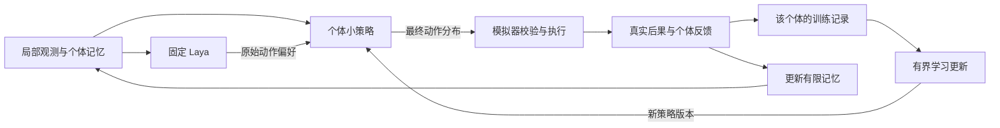

# 个体持续学习方案

状态：M0 已完成真实 Laya、独立 PPO 与预定对照，B 达到三种子上的探索性收益门槛；完整生态中的持续学习仍待 M5 验证。限制与证据见 [M0 结果](m0/RESULTS.md)。路线 B 优先、A/C 后续尝试的方向不变。

## 1. 产品与研究目标

**世界提供值得学习的问题，生命通过经历改变行为，前端把这个过程展示出来。**

我们希望同一个体能根据亲历的后果改变行动，在环境变化时继续适应，并在旧环境返回时保留或重新利用旧能力。与此同时，保留多代遗传与自然选择，分别观察一生之内和跨代发生的变化。

“持续”不指保证能力单调上升。适应、遗忘、失去可塑性、失败和死亡都应被记录。模型变得更有信心、参数发生变化或训练奖励上升，均不能单独证明学会了有效行为。

## 2. 术语与证据

| 机制 | 改变的对象 | 我们如何验证 |
| --- | --- | --- |
| 记忆 | 地点、经历、事件与经验统计 | 内容来源真实，行为能否使用记忆需对照 |
| 个体强化学习 | 根据行动后果更新的策略参数 | 参数和动作分布改变，并在留出评估中改善相关行为 |
| 持续学习 | 连续任务流中的学习状态与能力 | 环境变化后适应，检查旧能力保留和再次适应速度 |
| 遗传演化 | 后代性状分布、谱系存续 | 跨代统计，并控制或关闭个体学习作比较 |
| 经验传承 | 亲代、同伴向其他个体传递的后天信息 | 单独开启传承机制，与不传承对照 |

记忆更新可以是一种适应机制，但不应统称为神经网络权重学习。群体表现改善可能来自个体学习、选择淘汰、资源变化或出生差异，必须区分来源。

## 3. 三条路线

路线 ID 保持稳定，B 对应用户选择的“第二种”。

| 路线 | 结构 | 执行顺序与作用 |
| --- | --- | --- |
| A：经验适应 | 固定 Laya + 个体记忆、地点价值或经验统计 | 完整路线在 B 跑通后尝试；简化记忆版提前作为必要对照 |
| B：个体轻量学习 | 固定 Laya + 每个个体独立的小策略网络 | **主路线**，先验证一生内学习与变化环境适应 |
| C：Laya 持续微调 | 更新 Laya 的部分或全部参数 | B 跑通后作为研究路线，先评估训练资源、遗忘和更新作用范围 |

**路线 D（2026-10-02 起，用户确定的主方向）**：进化先天参数 + 终身学习后天参数，Laya 固定并作为系统 1 的感知直觉层，见 [EVOLUTION.md](EVOLUTION.md)。B 保留为对照，其“Laya 直接选动作”的接口因位置偏置问题需改为感知问题。

A/C 不自动取代 B，也不要求在第一版同时实现。对于 C，未来需选择个体适配参数还是共享模型更新：后者会让未亲历事件的个体间接获得知识，属于不同实验，不能标成独立个体学习。

## 4. 主路线 B 的大脑

共享的 Laya 权重保持固定，提供每个合法候选的初始偏好。小策略读取相同许可范围内的观测、有限记忆和 Laya 输出，决定最终动作。每个个体有独立参数和优化器，不通过共享梯度、经验池、归一化统计或隐状态传播其他个体经历。

初始实现建议采用对候选动作逐项评分的小网络，结合 Laya 偏好产生有限动作分布。候选特征与偏好按稳定映射对齐，不把“本次第 2 个选项”永久当成同一动作。若采用偏好融合，强度应有限，允许个体在有证据时改变 Laya 的倾向，而不是只能服从初始选择。

M0 采用 SB3-Contrib MaskablePPO，每个体有独立的 32 单元 actor/critic 隐层，共 4519 个参数；每 32 条经历更新，4 个 epoch、minibatch 16、学习率 0.001。输入为 66 维局部状态、有限记忆和六项 Laya 偏好；Laya 偏好作为特征，不强制小策略服从它。完整数值与预定判据见 [冻结配置](../experiments/m0/config/learning.json)。这是首个可测实现，不代表已证明最佳融合方式。PPO 使用自己的当前策略轨迹，不把任意历史经验当作新样本。

[开源复用调研](OPEN_SOURCE.md) 的 SB3 基线和 TorchRL 组件探针已在 M0 实际运行；本轮选 SB3-Contrib 实现独立策略，不同时维护两套正式训练栈。个体参数、优化器、经验与 RNG 隔离已专项测试。CleanRL 与 Avalanche RL 继续作为研究参考，不加入当前运行依赖。

Laya 的权重固定并不保证其偏好正确。必须提供去掉 Laya 的小网络对照，评估这种先验是否带来收益。Laya 原始分布、最终策略分布与实际执行分别保留，融合后的概率不再具有原模型置信度的原有含义。

## 5. 生命周期与数据归属

- 出生：按版本化初始化规则创建参数、优化器、经验缓冲与随机状态；默认不继承亲代学习参数或记忆。
- 经历：只接收本个体的许可观测、动作及可获得的后果，不读取全局食物真值、其他个体内心状态或未来事件。
- 更新：在固定模拟步边界、有明确样本与预算时进行；同一训练批次最多提交一次更新。
- 评估：冻结策略参数、优化器及训练统计；是否保留记忆变化必须在实验配置中声明。
- 死亡：结清最后一次行动的终止反馈，归档学习摘要；死亡个体不再行动，后代不复用其可变学习状态。
- 恢复：继续学习需恢复参数、优化器、经验、随机状态、版本与未结清行动；只恢复位置和能量不算恢复完整生命。

主路线的经验缓冲仅作有界训练数据，不等同于可直接供行为读取的记忆。训练器不得把缓冲中所有过去信息绕过产品规定的记忆容量直接塞入决策输入。

学习节奏以模拟步或累计经验数量定义，不按真实帧率或网络延迟定义。每次更新的样本数和梯度步数有上限，不通过无限后台训练让暂停中的个体继续成长。

## 6. 学习问题与顺序

| 阶段 | 世界问题 | 可观察线索 | 需要检验的能力 |
| --- | --- | --- | --- |
| L1：资源变化 | 食物稳定聚集 → 分散 → 恢复聚集 | 自己看到的食物、摄食结果、地点经历 | 探索与利用、环境适应、旧经验保留 |
| L2：延迟后果 | 某类食物即时补能，若干步后造成损伤 | 食物外观、摄入事件、自身后续变化 | 对延迟结果的关联，权衡短期与长期 |
| L3：有成本交流 | 发送有限信号或分享资源需要付出成本 | 接收到的信号、亲历资源变化与社会互动 | 是否学会使用信号、是否出现有益协作 |

三个问题都纳入目标，不作为被否定的想法。实施顺序为 L1 → L2 → L3，每个机制都有独立开关和对照。

L1 的环境阶段 ID 和切换时间不进入个体输入；L2 不直接标注“有毒”，食物外观与后果的关系需稳定到足以学习，并在留出实验中检验；L3 可先用有限离散信号，不预设其语义，也不宣称自动涌现语言。

## 7. 反馈、奖励与长期后果

环境反馈是实际发生了什么，奖励是训练者定义的优化目标，长期生态指标是观察结果，三者分别记录。

首个 L1 实验围绕维持可用能量、获得资源与避免死亡定义任务奖励，不直接奖励“去某方向”或“选择正确标签”。具体公式、权重、折扣和裁剪必须在训练前写入实验配置，调参使用训练环境，不能看过留出结果再改验收标准。

候选奖励分项包括能量稳态、实际摄食收益、运动成本与死亡终止项；最终取舍由 M0 的简单任务验证确定。检查长期休眠、来回移动、能量转移刷分和过度繁殖等利用奖励的行为。好奇心、繁殖与社交奖励后续单独加入，避免首轮无法定位奖励来源。

不同动作可跨多个模拟步，轨迹保存实际持续步数和期间的奖励序列；折扣按模拟时间一致计算，不能将长动作的整段回报当作单步回报。死亡是真正终止；实验时长截断、暂停与请求超时分别标识，不能误当死亡。

动作因资源竞争等原因执行失败也是真实经历：记录原选择、实际效果与拒绝原因，不把它偷偷改成一个成功的待机样本。网络超时和被取消、未执行的提案不生成虚构环境奖励。延迟后果需要保留足够长的轨迹或信用分配机制，不因眼前补能就把该行动固定标为正例。

严格学习实验中不降级。探索模式发生规则降级时，默认将跨越该区间的训练片段隔离，不直接喂给要求当前策略数据的训练器。

## 8. 证明学到了什么

主实验采用 A → B → A 的资源环境序列。相同个体在阶段切换时保留自己的参数和记忆，不重置学习过程。环境日程对各组相同，独立控制环境、动作探索、初始化与遗传随机流。

| 组别 | 作用 |
| --- | --- |
| 规则 | 基础生态和简单策略参照 |
| 固定 Laya，仅当前观测 | 测量不含经历记忆的固定预训练策略；这是显式移除记忆的消融 |
| 固定 Laya + 记忆适应 | 检验单靠记忆变化可以解释多少适应，属于 A 的简化对照 |
| Laya + 个体学习（B） | 主实验 |
| 小网络学习，无 Laya | 判断 Laya 是否提供额外价值 |
| B 的冻结版本 | 在同等记忆规则下停止参数更新，隔离参数学习的作用 |

上述对照分轮执行，不必同时加载全部组别。除明确的消融变量外，观测、动作、环境、身体条件和模拟预算一致，资源成本与真实计算成本分别报告。

早期 L1 学习实验关闭繁殖与性状变异，追踪同一初始个体或匹配队列；不隐式复活或只统计幸存者。死亡、灭绝与未完成阶段的结果纳入报告。需要跨完整 A/B/A 的测试时，可在明确标识的简化任务里控制死亡条件，但必须再在真实能量与死亡规则下评估，不能将简化任务结果冒充生态表现。

检查适应速度、变化后累计损失、回到 A 的能力恢复、死亡率、采食与能量指标、策略多样性，以及推理/训练成本。遗忘、负迁移和没有改善同样作为结果。

至少使用多个训练种子和未参与调参的评估环境。冻结评估默认参数不更新、保留各组一致的记忆更新规则；另做清空或冻结记忆的消融，区分即时记忆和参数学习。固定观测上的新旧策略差异是诊断证据，不能替代环境中的长期评估。

验收阈值在看留出结果前根据 M0 基线定义。主路线跑通至少意味着真实数据驱动更新、个体状态隔离、保存可继续，以及 L1 对照完整；只有评估支持才标为“已验证学习收益”。没有收益时报告并定位，不以参数变化替代目标完成。

## 9. 前端展示成长

- **经历时间线**：看到食物、摄入、能量变化、受到延迟损伤、收到信号、学习更新，各事件可追溯。
- **建议与选择**：并排显示 Laya 初始偏好、小策略最终分布和实际执行结果。
- **前后比较**：在同一个固定观测上比较学习前后策略，显示所用参数版本和记忆条件。
- **环境适应曲线**：标注 A/B/A 切换与恢复指标，显示失败和死亡样本。
- **出生与经历**：区分遗传性状、当前记忆与已学策略，避免把后天改变混成基因变异。
- **学习开关**：暂停世界、暂停参数学习和冻结评估含义不同；从同一完整快照生成允许学习/冻结分支。

“学会规避某种食物”需要相应评估证据。缺少证据时只显示具体事实，例如“该观测下该食物的选择概率由 0.6 变为 0.2”，并标注这是策略比较，不能生成未经支持的情绪或动机。

## 10. 与实施阶段的关系

P0 提前用明确标注的示例验证成长界面和用户流程，不产生真实学习证据；M0 验证真实 Laya 偏好接口、小策略更新和本机训练预算；M1–M4 建立环境、界面、记录与基础对照；M5 将 P0 的成长体验接入真实路线 B 与 L1、完成学习验收。M5 才是首个学习版本的交付节点。

M5 后先扩展 L2、L3，再对 A/C 做独立原型比较。备选研究可根据届时验证结果调整顺序，但不把主路线失败静默包装成备选成功。

Laya 官方已有领域微调材料，不能据此认为持续生态 RL 已开箱可用。训练算法、个体样本是否充足、遗忘缓解和实际吞吐都仍需验证，相关来源见 [研究依据](RESEARCH.md)。

## 11. M5 当前实现与证据边界（2026-10-01）

共享生态的主路线已实现为固定 Laya 偏好 + 每个生命独立的 MaskablePPO。当前输入 324 维，来自局部 9×9 资源/障碍视图、自身、至多 8 条地点记忆、局部邻居及七动作偏好；身份用于归属与去重，不进入网络。actor/critic 各一层 32 单元，每 32 次真实决策组成一次更新，短终止批次单独结算。初始配置使用学习率 0.001、4 个训练 epoch、batch 16；时间折扣按实际模拟步持续时间计算，参数与编码随完整检查点保存。

默认融合方式把 Laya 分布作为输入；开发对照另用有界残差加到偏好对数上，两种网络参数量相同。没有 Laya 的对照使用同预算网络，不伪造一次模型调用。具体世界、训练预算、融合与冻结留出规则以 [本轮实验方案](ECOLOGY_EXPERIMENT.md) 为准；开发参数不能因看到留出结果而悄悄改变。

每一轮分成暂存与确认：个体更新及提案先在独立副本准备；TS 模拟器预演实际动作反馈；Python 整轮结算成功后，前端的权威世界才提交同一轮。部分更新失败不发布任何个体的新状态。重复反馈凭事务身份与反馈哈希去重；真正死亡以零价值终止，实验时间截断以最终局部观测估计剩余价值，二者不混用。最终模型偏好也保留为实际调用证据。

冻结不更新参数、优化器、训练版本和步数计数；行为采样与世界记忆仍正常推进。冻结/解冻会清空尚未训练的部分批次，避免跨冻结区间拼接不连续的 on-policy 轨迹。后代通过自己的稳定身份种子新建网络、经验和优化器；不复制父代学习权重。完整恢复包包含世界与上述所有状态，动作记录仅能回放。

页面已经显示个体策略版本、最近实际更新及固定观测的动作概率变化，支持完整恢复与同起点暂停学习分支。参数变化只标记“发生更新”，不会自动标记“学会”。A/B/A 环境下的适应、死亡和旧环境返回结果由完整队列实验分析；留出评估及最终成长展示验收仍在进行。延迟损伤、信号、分享属于后续 L2/L3，没有冒充当前能力。

工程验证、真实运行及已知失败见 [执行记录](EXECUTION.md)；操作和故障处理见 [共享生态运行手册](ECOLOGY_RUNBOOK.md)。本轮尚无已经验收的普遍学习收益结论。
