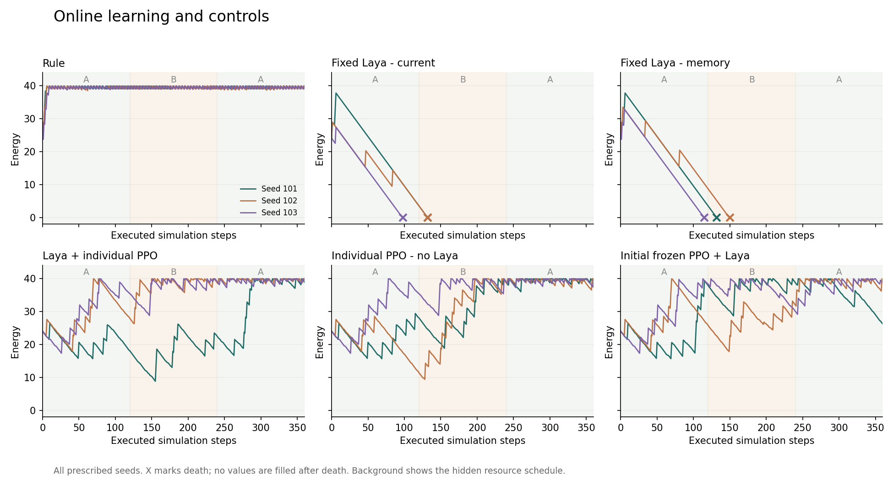
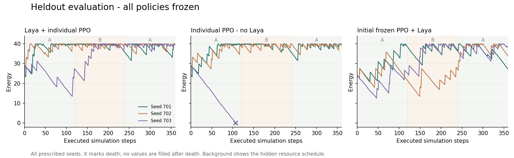

# M0 实验结果与运行预算

日期：2026-09-29。正式实验、离线推理、HTTP 和联合运行验证均已完成；逐项交付状态见 [完成审计](ACCEPTANCE.md)。本报告区分工程闭环与学习证据，不将 M0 等同于完整生态或 M5 持续学习成功。

## 结论

真实本地 Laya → TS 执行 → 个体反馈 → 独立 PPO 更新 → 检查点恢复 → 只读展示已经接通。正式实验保存 27 条轨迹、8066 次动作、5082 次模型决策（含时间截断的价值估计输入）与 72 次策略更新。全部动作逐条回放一致，六个真实学习检查点通过独立恢复与隔离核验。

路线 B 在本轮三组留出环境上达到预先设定的探索性门槛：相对初始化冻结 B，平均累计奖励增加 0.6533，三组均为正、死亡数不增加；相对无 Laya 学习器，平均增加 1.6727，两组为正、一组数值并列，死亡从 1/3 降至 0/3。后一个均值主要由种子 703 的死亡差异贡献。**这是小样本线索，不能证明 Laya 普遍有益或持续适应已经成立。**

固定 Laya 的两组在在线运行中均 3/3 死亡；简单情境正确率无法预测连续行为。初始冻结小策略在线和留出都全部存活，说明当前环境也允许较宽松的随机探索。后续应优先改善任务辨别力和融合诊断，见 [下一轮算法草案](NEXT_ALGORITHM_EXPERIMENT.md)。

## 配置与证据来源

正式配置为 [learning.json](../../experiments/m0/config/learning.json)：7×7 单体世界，360 步，A/B/A 各 120 步；训练种子 101/102/103，留出种子 701/702/703。规则、固定当前观测、固定记忆、B、无 Laya、冻结 B 各自运行独立世界；没有繁殖、竞争、变异或经验传承。64 步开发试跑不进入这里的收益结论。

共享固定英文 Laya checkpoint `55cf4c4ebb4ebe31b2550e8bdf3bd21b99753851`；每个体独立 MaskablePPO，actor/critic 各一层 32 单元，共 4519 参数。每 32 个实际经历更新，4 个 epoch、batch 16、学习率 0.001、gamma 0.98。B 将六项 Laya 偏好作为输入特征，不强制执行 Laya 动作。

奖励为 `(执行后能量−执行前能量)/10`，死亡另扣 1。它在完整轨迹上主要等于末尾净能量与死亡惩罚，接近容量上限的幸存者之间区分较弱。因此另外报告采食、死亡、阶段与完整能量轨迹。

配置 SHA-256 与训练/评估标准未变。运行时的 TS 世界、桥、观测编码、策略及调度源码均匹配运行开始保存的摘要。`offline_probe.py` 和 `download_model.py` 随后增加冷进程计时及固定 revision 下载支持，未参与正式实验；差异保留在 [分析记录](../../experiments/m0/evidence/experiment-01/analysis.json)。早期冻结之后适配器曾增加输入校验与隔离 tokenizer 副本，正式实验自己的源码清单记录的是实际运行版本，不能声称整个目录从最早冻结起都未变化。

## 全部对照

下表每组均为三个种子；死亡后的未执行后缀没有补零或复活。累计奖励不是模型置信度。

| 阶段 | 组别 | 平均累计奖励 | 死亡 | 平均执行步数 | 平均实际采食 | 更新次数 |
| --- | --- | ---: | ---: | ---: | ---: | ---: |
| 在线 | 规则 | 1.5680 | 0/3 | 360.0 | 107.06 | 0 |
| 在线 | 固定 Laya：当前观测 | -3.4000 | 3/3 | 120.7 | 11.67 | 0 |
| 在线 | 固定 Laya：有记忆 | -3.4000 | 3/3 | 132.3 | 15.00 | 0 |
| 在线 | B：Laya + 独立 PPO | 1.5540 | 0/3 | 360.0 | 101.10 | 36 |
| 在线 | 无 Laya 小网络 | 1.5780 | 0/3 | 360.0 | 102.60 | 36 |
| 在线 | 初始化冻结 B | 1.0920 | 0/3 | 360.0 | 99.60 | 0 |
| 冻结留出 | B：Laya + 独立 PPO | 1.5500 | 0/3 | 360.0 | 97.34 | 0 |
| 冻结留出 | 无 Laya 小网络 | -0.1227 | 1/3 | 275.7 | 67.21 | 0 |
| 冻结留出 | 初始化冻结 B | 0.8967 | 0/3 | 360.0 | 98.31 | 0 |

### 留出逐种子差值

| 种子 | B 奖励 | B − 初始化冻结 B | B − 无 Laya 学习器 |
| --- | ---: | ---: | ---: |
| 701 | 1.5580 | 1.2500 | 0.0000 |
| 702 | 1.5280 | 0.5520 | 0.0540 |
| 703 | 1.5640 | 0.1580 | 4.9640 |

预定门槛为平均差至少 0.1、死亡数不增加、至少两组正差。701 的 B/无 Laya 差为 2.2×10⁻¹⁶，是累计浮点误差，按 10⁻⁹ 容差记为并列；保留了原始差值和原始计数。消除此误差后两个门槛仍通过，没有降低通过阈值。

所有留出参数与优化器冻结，记忆仍按相同规则更新。世界种子配对，但学习策略和初始化策略的采样 RNG 延续各自历史，未重置为逐次配对的探索流；加上仅三个种子，本轮不提供统计显著性或纯参数效应的强因果结论。

### 变化环境与恢复

B 三个个体都完成了 A/B/A 的全部阶段。下面是每步平均奖励及预定的返回 A 首 20 步减初始 A 首 20 步代理指标；它受起始能量、上限和资源积累影响，不能直接解释为遗忘程度。

| 训练种子 | A 每步均奖 | B 每步均奖 | 返回 A 每步均奖 | 返回 A 首 20 步差 |
| --- | ---: | ---: | ---: | ---: |
| 101 | -0.00497 | 0.00367 | 0.01368 | -0.02230 |
| 102 | 0.00323 | 0.00900 | 0.00100 | 0.00740 |
| 103 | 0.00950 | 0.00298 | 0.00075 | 0.02760 |

全部个体的阶段样本数与 20 步窗口保存在 [analysis.json](../../experiments/m0/evidence/experiment-01/analysis.json)。固定 Laya 死亡后的阶段保持缺失；没有按幸存者平均后宣称恢复。当前未定义时间到恢复的达标阈值，不能报告已测得的恢复时间。A/B/A 仅改变新补给的分布，旧食物不消退；尚未证明环境切换要求学习或存在真正的持续适应。

## 模型选择与运行成本

36 个情境分为开发/留出各 18，其中各有 12 个明确题和 6 个无唯一答案的策略题。多语言数值模板开发 0/12，改自然语言后 1/12；英文相同模板开发 12/12，因此先选择英文模型，再得到留出 12/12。这些近似模板只覆盖当前位置摄食与东/南/西单目标，不代表复杂导航、北向明确题、交流或生态泛化。

固定 Laya 短情境批量测量：每档三次，全为 MPS，无 CPU 回退。机器同时有其他计算负载，结果是测量时的预算，不是实时规模承诺。

| 批量 | 整批中位耗时 ms | 测量次数 |
| ---: | ---: | ---: |
| 1 | 259.4 | 3 |
| 8 | 1380.5 | 3 |
| 16 | 2514.6 | 3 |
| 32 | 5212.3 | 3 |
| 48 | 6857.4 | 3 |

联合测量包含真实 Laya、独立策略采样、TS 执行与每个体一次 PPO 更新，每档 33 步。它使用实际变化的观测，与上表重复短情境不是同一负载，不能直接相减当作学习开销。

| 独立个体 | 总动作数 | 总耗时 s | 整轮中位 ms | 整轮最大 ms | 采样 RSS 峰值 MiB | MPS driver 峰值 MiB |
| ---: | ---: | ---: | ---: | ---: | ---: | ---: |
| 1 | 33 | 7.63 | 210.2 | 689.2 | 264.7 | 2056.7 |
| 8 | 264 | 65.70 | 1918.7 | 2691.3 | 264.6 | 3118.4 |

联合进程 RSS 高水位为 2788.2 MiB，包含模型加载过程；采样 RSS 只反映对应测量窗口，分页也会影响口径。RSS 与统一内存的 MPS driver 数值不能相加。每个体参数张量 18,076 bytes、优化器张量 36,184 bytes、rollout 数组 10,240 bytes；这些不包含 Python/框架与记录开销。

正式实验用时 50.56 分钟（不含开始前模型加载），72 次更新中位 36.60 ms、最大 343.73 ms；桥接总耗时 42.67 秒。离线探针从脚本开始、含依赖导入与加载，到首次真实动作执行为 27.08 秒。不同时间的负载不同，不把速度波动归因于算法改善。

## 确定的初始预算

- 默认英文 checkpoint 与 `local-foraging-en-v2` 编码；一份固定模型共享推理，每个体独立小策略。
- M0 单体世界每执行一个动作做一次决策；已测联合范围为 1/8 个独立实例。
- 后续 M1 从 8 个生命开始，目标每个模拟秒一次决策（10 个模拟步）；等待一轮决策完成再推进对应边界。8 个独立世界的测量不等于已经实现 8 个生命的共享生态。
- 不承诺墙钟实时：本次 8 个实例整轮中位约 1.92 秒、最大约 2.69 秒。48 仅作为批量推理测试档，不作为初始交互规模。
- 初始 PPO 预算沿用每 32 条经历更新、4 epoch、batch 16；暂停不训练，留出评估冻结。后续扩大规模、引入繁殖及竞争需重新测量。

机器可读决定见 [runtime-budget.json](../../experiments/m0/config/runtime-budget.json)。

## 可靠性、复现与展示

Python 进程禁止 socket.connect/connect_ex 并启用 SDK 离线标志后，真实推理和 TS 执行成功，探针未捕获外连尝试；未关闭操作系统网络，不宣称进行了全系统网络隔离。HTTP 已实测缺失模型 503、无效输入 422、忙碌 503/Retry-After、恢复后的真实响应、旧尝试拒绝及重复提交不改变世界。没有规则降级冒充模型。

首轮 HTTP 探针受本机代理影响，请求未到达本地服务且错误体不是 JSON。修正为仅对 loopback 使用无代理客户端，同时保留非 JSON 错误状态；重跑通过。失败日志保留于 `post-validation.log`，没有删除失败尝试。SDK 修改 tokenizer 配置的问题已改为隔离运行副本；原始下载文件 SHA-256 全部保持一致。

7 项 TS 测试、8 项 Python 测试通过。完整真实日志 8066 次转换逐条回放一致；六个第 256 步检查点恢复后，更新一个分支不会影响另一个，两个独立恢复分支更新和下一次行动一致并匹配原始执行。恢复使用原记录的真实偏好，不计作新推理。当前 runner 没有完整实验自动断点续跑 CLI，不能把恢复语义测试当作已交付自动续跑。

真实展示导出包含全部 27 条轨迹，8066 帧的位置、资源、能量、动作、事件、奖励和模型记录均与源日志核对一致。页面只读、不训练；三种外形仅重绘同一记录。完整生态干预、繁殖与实时前后端仍在后续阶段。浏览器证据见 [走查](UI_VERIFICATION.md)。

依赖与 checkpoint 来源、许可、下载清单、原始耗时及完整日志均保存在 `experiments/m0/`。图表额外使用 Matplotlib 3.10.8，单独锁定于 `requirements-m0-analysis.lock`，安装时保留了所有算法依赖版本。运行与重跑见 [RUNBOOK](RUNBOOK.md)。
